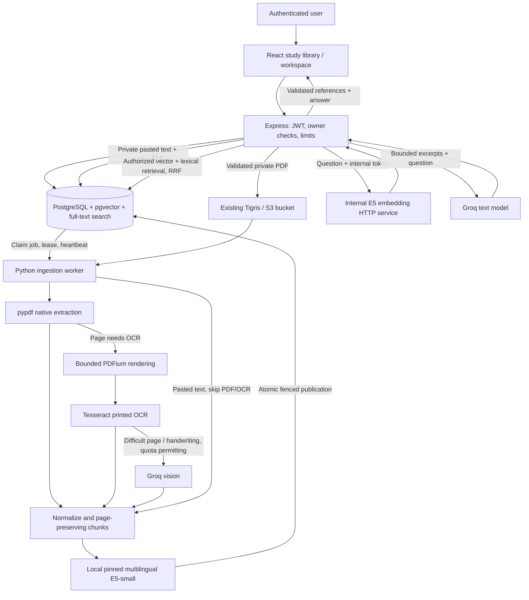
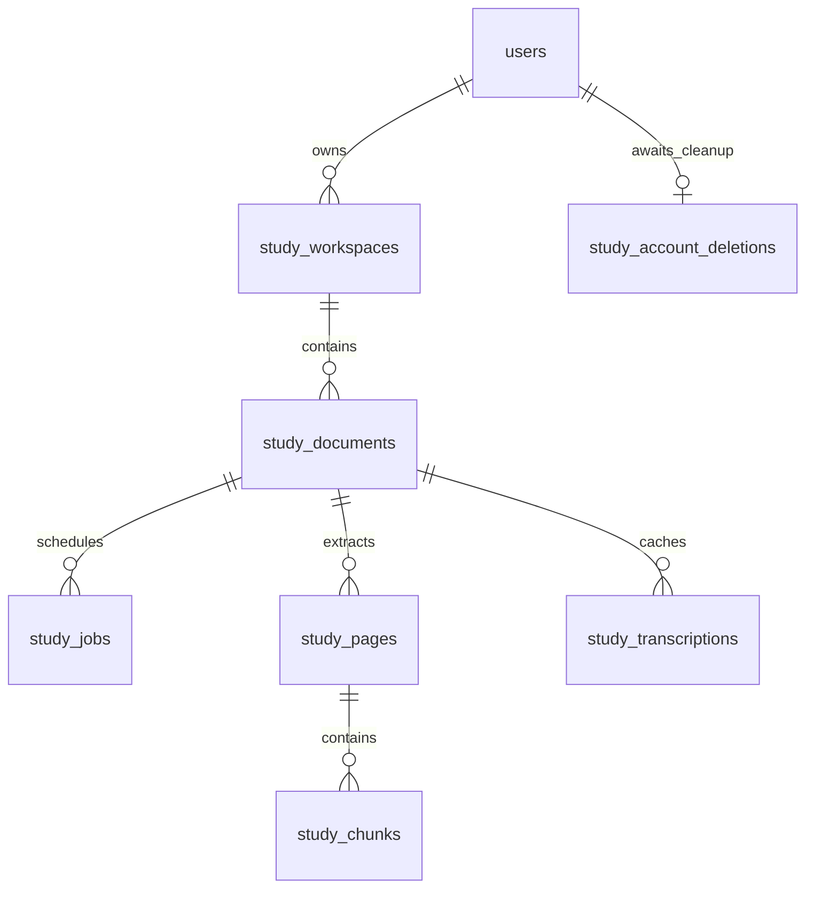

# EduSphere / EDUS: architecture and interview preparation

This guide describes the implementation in this repository, including private study
subjects and PDF/pasted-text RAG. It separates implemented behavior from deployment
requirements and future improvements. Do not claim a performance figure, accuracy,
user count, or production integration that you have not measured yourself.

Read alongside [the deployment guide](private-study.md) and
[the Python worker guide](../backend/study-worker/README.md). Provider model availability
and quotas are changeable; the linked official documentation and your own account
console are authoritative.

## 1. Explain the project clearly

### Thirty-second introduction

> EduSphere is an academic resource platform with student, professor, and admin roles.
> Its EDU AI feature adds private study workspaces where a user can upload a syllabus,
> notes, or both, using PDFs or pasted text. The system extracts and chunks the material,
> generates embeddings locally, and stores them in PostgreSQL with pgvector. It combines
> semantic and keyword retrieval, then asks an allowlisted Groq model to answer using
> the retrieved material with source references. I bounded uploads, storage, processing,
> and model usage so the feature can operate within a limited budget.

### Two-minute technical explanation

Start with the user problem: ordinary chat does not automatically know a student's
private course material. Sending every uploaded PDF with every question wastes context
and model quota. Scanned PDFs also need text extraction before retrieval can work.

Describe two independent paths. Ingestion accepts authenticated, owner-scoped material,
validates quotas, and creates a durable database job. Python extracts native PDF text,
uses Tesseract for printed scans, and can use Groq vision for difficult or handwritten
pages. Pasted text skips PDF storage and OCR. Both paths create page-preserving chunks
and normalized, 384-dimensional E5 embeddings.

Question answering embeds the question with the same pinned model, filters eligible
sources by owner and workspace, retrieves semantic and lexical candidates, combines
their ranks, and packs bounded excerpts into the model prompt. The backend validates
the response's source references and checks that its sources remain accessible.

Finish with the tradeoff: PostgreSQL handles relational state, vectors, lexical search,
quotas, and jobs, reducing infrastructure to operate. This is appropriate for a bounded
initial corpus. It does not imply unlimited scale, perfect OCR, or hallucination-free
answers. A deployed system also needs migrations, running workers, credentials, and
measured evaluation.

### Explain your contribution honestly

Use “I designed/implemented/tested” only for work you can personally explain. If asked
about assistance, describe the tools you used and how you reviewed and validated their
output. Being able to trace one upload, one question, and one deletion through the code
is more persuasive than memorizing a list of technologies.

## 2. The whole platform

| Layer | Repository choice | Purpose and reason |
| --- | --- | --- |
| Browser | React 19, TypeScript/JavaScript, Vite, Tailwind | Existing application stack; component state for subject creation, processing, chat, and practice |
| Routing | React Router | Private study library and workspace screens within EDU AI |
| API | Node.js / Express | Reuses existing authentication, authorization, resource routes, and storage integration |
| Relational data | PostgreSQL; existing Neon configuration | Users, resources, relationships, and durable study state |
| Existing data access | Drizzle schema and postgres.js | Existing entities use the established stack; study operations use parameterized SQL and explicit migrations |
| Vector search | pgvector inside PostgreSQL | Stores vectors beside the metadata needed to authorize them |
| Lexical search | PostgreSQL full-text search and GIN | Finds exact terminology, abbreviations, and identifiers that semantic similarity can miss |
| Originals | Existing private Tigris/S3-compatible storage | Keeps large PDF binaries outside relational rows; private GET access is short-lived |
| PDF/OCR/embedding work | Python worker | Uses the Python document/ML ecosystem without blocking Express requests |
| Query embedding | Internal authenticated Python HTTP service | Lets Express reuse the same local model family and revision as ingestion |
| Hosted generation | Allowlisted Groq text and vision models | Uses the requested provider with explicit free-plan admission controls |
| Cache | Existing optional Redis/Valkey support | Helps existing public endpoints; it is not the RAG job queue or quota authority |
| Deployment | Existing frontend deployment and backend GitHub workflow; worker/container templates | API deployment alone does not provision the new database schema or Python processes |

Do not describe the project as purely MERN: its database is PostgreSQL, not MongoDB.
Do not say all of its SQL is generated by Drizzle: the study subsystem has explicit SQL.

### Existing platform flows beyond RAG

**Academic catalog:** subjects organize resources by academic metadata such as branch
and semester. Resources store a subject relationship, title/type, uploader, slug, and
either object-storage metadata or an external/video link. The resource listing joins
subject/uploader metadata and supports filters and a parameterized case-insensitive
text query. That catalog query is not the private chunk embedding search. The current
listing should be reviewed for pagination before a large catalog; do not claim it has
infinite-scroll database efficiency merely because the UI is responsive.

**Publishing:** professor/admin authorization protects shared subject/resource mutations.
Public-resource upload has an existing presigned PUT flow for allowed MIME types,
followed by resource registration. Private study intentionally uses the stricter
server-mediated path described below. Shared-resource controllers have their own
ownership/legacy-content restrictions; role middleware alone is not the whole policy.
Private object prefixes are rejected by public resource registration.

**Saved resources:** a join table relates users and resources, with a unique user/resource
pair to prevent duplicates. This is a many-to-many relation, not a copy of every saved
PDF. Announcements attach optionally to subjects and have an author identity.

**Analytics:** session/resource/quiz/AI event tables support professor and platform
analytics. `/api/analytics/my` is professor/admin gated and varies its cache by user;
platform and selected-professor analytics are admin gated. Explain event collection and
authorization separately. Analytics events are not the billing/quota ledger and should
not be used as a substitute for transactional admission counters.

**Existing chapter EDU AI:** the application already has curated syllabus/chapter
tutoring, grading, flashcards, and MCQs. Chapter chat streams SSE responses, whereas
the private study chat currently returns its validated structured result. Both hosted
text paths now use the shared free-Groq wrapper and budget. Do not claim every AI
feature uses private RAG just because both live under EDU AI.

**Caching:** resource lists/announcements use 120-second TTL defaults in their routes,
subjects 300 seconds, and analytics 90 seconds. Cache keys include route/query/params
and, where configured, user or role. Successful mutations broadly invalidate cached
entries. Redis cache failures return a miss so the underlying database remains usable.
The broad asynchronous invalidation is simple, but can cause extra work or short stale
windows; it is not a strong cache-consistency protocol. The auth rate limiter can use
Redis when configured and otherwise falls back to memory. That fallback does not give
cross-replica rate consistency; critical study counters use PostgreSQL instead.

**Frontend:** components render loading/error/empty/success states; route protection is
for navigation convenience while API authorization remains mandatory. The API client
coordinates refresh attempts and keeps authenticated responses associated with the
current account. An aborted request or account change must not repopulate the next
user's screen with old private content. The private study UI polls processing status,
opens short-lived source access, and keeps its current conversation in component state.
The Vite production build emits deployable assets; it cannot keep embedded API secrets
private. A PWA/service worker requires version-aware cache behavior after deployments;
do not cache private API responses indiscriminately.

**Deployment:** existing automation targets `main`/`Priyanshu`, checks the backend stack,
and restarts its configured service. The frontend has its own deployment. Repository
diagrams mentioning a different process manager or an old Llama model should not be
treated as proof of the currently deployed process/model; inspect the actual workflow
and environment. The RAG worker/container template is separate operational work.

## 3. Architecture

There are **two Python processes** in the supplied setup: ingestion and the embedding
HTTP service. Each may load model weights. Neither is automatically created by a
frontend deployment or an Express restart.

### Where each kind of data lives

| Data | Location |
| --- | --- |
| Account and academic/resource metadata | Existing PostgreSQL tables |
| Workspace ownership, titles, document metadata, statuses | Study tables in PostgreSQL |
| Original PDF | Private object storage |
| Original pasted content | `study_documents.pasted_text`, private PostgreSQL row |
| Extracted pages, extraction method/quality | `study_pages` |
| Chunk text and 384-dimensional vectors | `study_chunks` |
| Reusable successful vision readings | `study_transcriptions` |
| Jobs, attempts, lease/fencing state | `study_jobs` |
| Shared admission counters | `study_usage` |
| Pending account deletion | `study_account_deletions` |
| Current study conversation | Browser component state; clears when leaving the page |
| Model weights | Persistent local Hugging Face cache |

PDF page images are transient by default. Optional persisted derived images have a
separate bound; they are not included in the advertised original-file byte allowance.
Never claim the PDF allowance bounds every byte used by vectors, extracted text,
indexes, model weights, backups, or temporary rendering.

## 4. Do I need API keys or another vector database?

**You need configuration and running infrastructure. You do not need a separate hosted
vector database or hosted embedding API.** A vector database is a capability here:
PostgreSQL provides it through pgvector.

| Setting or dependency | Needed? | Explanation |
| --- | --- | --- |
| `DATABASE_URL` | Yes | Existing PostgreSQL connection; target must have all study migrations and pgvector |
| `GROQ_API_KEY` | Yes for generated answers and Groq OCR | Server-side only; local parsing and embeddings do not use it |
| `STUDY_GROQ_FREE_PLAN_CONFIRMED=true` | Yes before hosted calls | Operator confirmation after actually checking account billing; it does not inspect or change the Groq plan |
| `AWS_ACCESS_KEY_ID`, `AWS_SECRET_ACCESS_KEY`, `AWS_BUCKET_NAME` | Yes for PDF ingestion | Existing private storage credentials; endpoint/region must match both API and worker |
| `AWS_ENDPOINT_URL_S3`, `AWS_REGION` | As required by storage deployment | Tigris/S3 endpoint and region configuration |
| `STUDY_INTERNAL_TOKEN` | Yes | Strong random shared secret for Express-to-embedding-service authentication; generate at least 32 characters |
| `STUDY_EMBEDDING_URL` | Configure when necessary | Default internal URL is `http://127.0.0.1:8091` |
| Hugging Face API key | Normally no | This public embedding model can download without a private model token; outbound access and disk are still needed |
| OpenAI key | No | No OpenAI generation/embedding API is part of this design |
| Pinecone/Qdrant/Weaviate account | No | No separate vector service is deployed |
| Existing JWT/OAuth/Clerk settings | Yes for the existing login flow | These predate RAG and must continue to work |
| CPU, RAM, disk, Tesseract, Python services | Yes | Local models avoid a hosted embedding bill; they still consume infrastructure |

Do not paste credentials into chat, screenshots, frontend environment variables, or Git.
Frontend build variables are visible to users. The Groq key belongs only on the backend
and the authorized OCR worker.

### Configuration diagnosis from this workspace

A read-only check of the database configured by the backend `.env` found no study
workspace/usage/account-cleanup tables and no installed `vector` extension. Groq and
storage credential variables were present; the internal embedding token was absent and
the free-plan confirmation flag was unset. Presence does not prove credentials are valid.
The live deployment could use different environment values, so verify the deployed
process before treating this as a complete production diagnosis.

This is consistent with the screenshot's `/api/study/workspaces` **503**. Listing
workspaces queries PostgreSQL and does not call Groq. Adding an AI key alone cannot
create missing tables. The separate `/api/auth/refresh` **401** can indicate a missing
or invalid refresh cookie; it is a separate failure path.

### Concrete setup order

1. Select the intended staging database and private bucket. Verify permissions and
   backup/recovery for any production database.
2. Populate the existing backend/worker secrets and a matching internal token. Verify
   the Groq organization is Free and paid billing is disabled before setting its flag.
3. From `backend`, run `npm run migrate:study`. This applies the four additive study
   migrations, including pasted text. The runner uses an advisory lock and checksums.
4. Install/start the worker and embedding service as described in their guide. Use the
   same immutable E5 revision in ingestion and querying; keep port 8091 internal.
5. From `backend`, run `npm run study:check`. It reports credential presence, selected
   schema checks, and embedding identity/health without sending anything to Groq.
6. Deploy/restart the API and frontend in coordination with the schema. Check ingress
   upload size/timeouts and bucket GET CORS for the PDF viewer.
7. Run a real PDF/text/scan/handwriting acceptance test, including two-account isolation,
   deletion during indexing, and quotas. Readiness checks do not prove a worker is alive.

That initial database check made no changes. During the subsequently authorized host
deployment, the schema and persistent services were provisioned. CI/CD now applies
study migrations and restarts/checks both Python services when their user units are
enabled; initial dependency/model/secret provisioning is still separate. See the
[host runbook](../backend/study-worker/deploy/README.md) for current operations.

## 5. Ingestion, from button click to searchable source

### PDF path

1. User chooses a private subject, source kind, and PDF. Each subject has at most one
   syllabus and five notes sources, counting PDFs and pasted blocks together.
2. Express verifies authentication, UUIDs, ownership, filename, declared byte size,
   available source count, storage budget, and upload admission limits.
3. The database locks the owner row during admission. This serializes competing changes
   for that account. A reservation charges the applicable limits before storage writes.
4. The browser sends one multipart PDF to Express. There is no browser storage PUT URL
   that can be replayed repeatedly to create unaccounted objects.
5. Express receives bounded temporary data, verifies actual size and PDF signature,
   computes SHA-256, and handles duplicate content before another permanent write.
   A PDF header is only an early check, not proof a document is valid.
6. The object is written under an owner/document UUID key. The record becomes queued
   and a durable ingestion job is admitted.
7. Python claims a job, starts its lease heartbeat, downloads the bounded original, and
   performs actual parsing/page-count validation.
8. Each page follows native extraction, printed OCR, and optional difficult-page vision
   as needed. A small selectable heading must not hide a scanned body underneath it.
9. Reliable text is normalized, chunked, embedded, and prepared outside long database
   transactions. Unclear vision lines are excluded from searchable text.
10. Publication locks/rechecks the job lease, document, and workspace. Only a current,
    authorized job can atomically publish its pages/chunks and ready/partial status.

### Pasted-text path

Syllabus and notes each have their own **Upload PDF / Paste text** choice. A user may
paste the syllabus while uploading notes, upload the syllabus while pasting notes, or
paste both. Text is validated independently on the server: nonempty normalized content,
title, permitted controls, at most 50,000 JavaScript character units and 64 KiB UTF-8.
The byte bound matters because character count alone does not bound multibyte storage.

A stable submission key makes retries idempotent. Reusing that key with changed content
is rejected. Identical same-kind text is deduplicated within the workspace. A successful
text source and its job are inserted together; no PDF conversion, upload reservation,
object write, rendering, or OCR is needed. Text still consumes source/admission/storage
allowances and passes through the same chunk/embedding process. It uses an internal
segment number for storage consistency, but citations say **pasted text**, not “PDF page 1.”

The source viewer renders text as escaped React text. A pasted `<script>` string is
displayed, not executed as HTML. A failed mixed batch retries unfinished sources without
recreating the workspace or resaving completed sources.

### States and partial success

PDFs progress through `reserved → uploading → queued → processing → ready/partial`,
with `failed` when no useful result can be published. Text starts at `queued`.
Deletion uses `deleting → deleted`. Processing-stage detail gives the UI more specific
feedback while the durable document status remains stable.

`partial` means useful passages may be available while some pages are unreadable or
quota-limited. It is preferable to silently presenting a document as complete. A quota
limited handwritten document is not promised to finish after one retry.

## 6. OCR and Groq: answer this precisely

Groq is an inference provider. The selected model determines whether a request can
process images. Its text models are used for tutoring; its allowlisted vision model is
used for difficult-page transcription. The application does not upload a raw multi-page
PDF to a text model and expect it to perform the entire ingestion pipeline.

The current vision allowlist uses `qwen/qwen3.8-27b`. The provider documents image/OCR
support; handwriting quality must be measured on your own notes. This model is listed
as **preview**, which is an availability/deprecation risk. The design sends one bounded
page image per call and exposes partial/unavailable results if vision cannot run.
[Groq vision documentation](https://console.groq.com/docs/vision),
[Groq model catalog](https://console.groq.com/docs/models).

Native selectable text is cheapest and normally most faithful. Printed Tesseract OCR
does not require an inference API key. Vision helps with handwriting and difficult
layouts but can invent plausible readings; a low temperature or confidence label does
not establish correctness. Mathematical notation, tables, diagrams, and poor photos
remain important limits. Preserve originals and show page-level review status.

Successful unambiguous vision readings are cached using immutable document/page/model/
prompt-version identity. That prevents retries from spending the same free allowance
on completed pages. Changing a prompt/model must invalidate its cached interpretation.

## 7. Embeddings and chunking

The model is `intfloat/multilingual-e5-small`, pinned to revision
`614241f622f53c4eeff9890bdc4f31cfecc418b3`. It produces 384-dimensional vectors.
Retrieval inputs use `query:` for questions and `passage:` for stored chunks. Vectors
are normalized. Prefixes and consistent preprocessing matter: matching dimensions
alone does not make embeddings from different models/revisions compatible.
[Official E5 model card](https://huggingface.co/intfloat/multilingual-e5-small).

The implementation uses 450-token chunks, including relevant model prefix/special-token
budget, with 50-token overlap. It preserves page boundaries for PDF references.

Why this choice:

- Whole documents can exceed the embedding model's input and blend unrelated topics.
- Very short chunks lose definitions and explanatory context.
- Larger chunks increase context and may dilute relevance.
- Overlap reduces boundary loss but duplicates text, vectors, and retrieved evidence.
- A compact local multilingual encoder keeps the hosted API dependency and CPU footprint
  smaller than a much larger encoder, at the cost of potential retrieval-quality loss.
- Page preservation simplifies citations, but a paragraph spanning two pages can split.

These are engineering defaults, not a benchmark-proven optimum. Evaluate alternative
chunk sizes, overlaps, and models on real course questions before claiming improvement.
The worker embeds batches of 16; chunk IDs are deterministic for their document/page/
chunk identity. It also bounds page text, document text, and chunks to contain unusually
expensive documents. Pasted content may contain multiple chunks inside one text segment.

### Vector math you should know

For vectors q and d:

`cosine_similarity(q,d) = dot(q,d) / (norm(q) * norm(d))`

With unit-normalized vectors, this equals their dot product. pgvector's cosine distance
operator is `<=>`; ordering ascending selects nearest vectors. Cosine distance is not
a calibrated probability that an answer is correct. A distance of 0.2 does not mean
“80% factual accuracy.”

One 384-dimensional float32 vector contains `384 × 4 = 1,536` raw value bytes. Ten
thousand vectors therefore contain about 15.36 MB of raw floats, **before** database row,
text, index, transaction, replication, and backup overhead. This is a storage calculation,
not a measured memory or latency result.

Changing the model requires re-embedding existing chunks and queries consistently.
A safe upgrade uses a versioned parallel index, evaluation, controlled cutover, and
rollback, rather than mixing incompatible vectors in the same search.

## 8. Retrieval and answer generation

### Authorization comes before ranking

The query builds a materialized eligible set for the authenticated owner, workspace,
nondeleted sources, searchable statuses, selected document IDs, and embedding identity.
Both vector and lexical branches read this set. Filtering after ranking could leak
private candidates and harm recall when unauthorized rows occupy the top positions.
UUIDs alone provide no authorization.

### Hybrid search

1. Embed the current question with the internal E5 service.
2. Retrieve the top 24 exact cosine candidates from eligible chunks.
3. Retrieve the top 24 PostgreSQL full-text candidates using `websearch_to_tsquery`,
   the `simple` text configuration, and `ts_rank_cd`.
4. Fuse ranks with reciprocal rank fusion (RRF): `score = Σ 1 / (60 + rank)`.
5. Consider the top 16 fused candidates, deduplicate and pack at most eight sources,
   approximately 10,000 excerpt characters total and 1,800 per excerpt.
6. Send the bounded evidence and question to Groq. Validate source IDs and check source
   availability again before returning the answer.

Example: chunk A is vector rank 1 and lexical rank 10. Its score is
`1/61 + 1/70 ≈ 0.03068`. Chunk B is vector rank 2 only, scoring `1/62 ≈ 0.01613`.
A wins because both searches support it. RRF combines ranks rather than assuming cosine
and lexical scores share a meaningful numerical scale.

The lexical branch is **not BM25**, and RRF is **not a learned cross-encoder reranker**.
The current vector branch is **exact search**, with no HNSW or IVFFlat index. The GIN
index supports lexical search, not vector nearest neighbors.

### Why exact vector search initially?

Each user has a bounded private corpus. Exact search avoids approximation errors and
filtered ANN recall complications while keeping the first implementation simpler.
Its cost still grows with eligible chunks, and filtering/index plans must be measured.
At higher scale, compare HNSW, partitioning, and a separate vector service using actual
filtered workloads. PostgreSQL/pgvector supports both exact and approximate search;
the presence of the extension does not imply this application uses ANN.
[pgvector documentation](https://github.com/pgvector/pgvector).

### Answer modes, practice, and factual limits

“My sources only” tells the model to use selected evidence and report insufficiency.
“General tutor + my sources” permits broader explanation while identifying source
evidence separately. These are model instructions, not mathematical correctness proofs.

Practice generation uses source coverage, including beginning/middle/end material,
when no focused topic is given. It produces bounded flashcard/MCQ JSON, validates its
structure and referenced source IDs, and shows answers/explanations in the UI.

A valid source ID proves that the referenced excerpt was supplied and authorized. It
does **not** prove every generated claim follows from that excerpt. Formal entailment
evaluation, citation precision, and a labeled question set are future validation work.
Multi-turn history is bounded for context; the current question drives retrieval, so
ambiguous follow-ups may need an explicit subject. Query rewriting is not implemented.

## 9. Database design and consistency

`study_usage` contains scoped counters rather than a conventional child relationship
for every scope. The migration ledger records checksums for applied migrations.

Important database invariants:

- Active workspace slot is unique per owner, with slot constrained to 1–6.
- Only one nondeleting/nondeleted syllabus can exist per subject.
- Active document hashes prevent duplicate admitted content within a subject.
- Active job uniqueness prevents duplicate queued/processing jobs of the same kind.
- A chunk's page must exist; page/chunk keys keep source identity explicit.
- PDF sources have an object key; text sources have private content and no object key.
- Text submission keys are unique within a workspace and preserve retry identity.

Why both application validation and constraints? Validation gives useful error messages
and checks aggregate limits. Constraints are the final defense against concurrent or
unexpected writers. A frontend-disabled button cannot enforce a six-subject rule.

The owner row lock serializes admissions for the same account. Without locking, two
requests could both observe five subjects and independently admit a sixth and seventh.
Quota updates use transactions and a consistent key ordering to reduce deadlocks.
Transactions are short; OCR, object transfers, and inference do not run inside them.

## 10. Durable jobs, failures, and deletion

Workers claim jobs with `FOR UPDATE SKIP LOCKED`, allowing independent workers to skip
already-locked work. A claim assigns a lease token. Default lease duration is 180
seconds, with a heartbeat every 20 seconds and bounded automatic attempts/backoff.
An expired lease can be reclaimed after a crash.

This gives **at-least-once execution**, not a universal exactly-once guarantee. A stale
worker may finish computation after another worker has reclaimed its job. Publication
checks the current lease token and expiry; stale work cannot replace current data.
Deletion and workspace status are also rechecked before publishing, preventing a deleted
subject from reappearing when an old OCR request returns.

Deletion is a workflow:

1. Tombstone the source/workspace so new retrieval excludes it immediately.
2. Queue durable cleanup. Freeing a subject slot does not immediately refund bytes for
   an object that still exists.
3. Delete the original and any persisted derived artifacts, then clear private text,
   pages, chunks, and transcriptions. Text sources skip object-storage calls.
4. If storage is unavailable, retain retryable state and retry cleanup later.

S3 and PostgreSQL do not share one ACID transaction. Immutable keys, leases, cleanup jobs,
bounded retries, and reconciliation reduce crash inconsistencies; they do not eliminate
every possible orphan. A previously issued 60-second GET link can remain usable until
expiry even after a database tombstone. Backups and copies already downloaded require
separate retention considerations.

Account deletion first blocks new private admissions and requests cleanup. It returns
`ACCOUNT_CLEANUP_PENDING` until cleanup completes; a retry then removes the account and
study tombstones. Existing public-resource deletion behavior is coordinated afterward.

## 11. Authentication, authorization, and privacy

Existing authentication issues 15-minute access JWTs and seven-day refresh JWTs. Refresh
uses an HttpOnly cookie; Secure/SameSite behavior depends on environment configuration.
The refresh endpoint verifies the token, reloads the user, and issues a fresh access
token. It does **not** implement refresh-token rotation or a persistent revocation list.
Logout clears the cookie; that alone does not revoke an already stolen signed token.

Existing frontend authentication integrates Clerk with the app's backend identity flow;
other existing login paths include credentials and Google/GitHub OAuth. Do not describe
Clerk and backend JWTs as two unrelated user databases without explaining the bridge.
Professor login also has its existing PIN step.

RBAC determines allowed platform actions. Ownership determines access to a private study
subject. An admin cannot simply view another user's notes through these routes. Backend
middleware verifies access-token claims; it does not refresh roles from the database on
every request. A role change may therefore require refresh or token expiry to take effect.

Other controls include parameterized SQL, bounded bodies/files, immutable private object
keys, no plaintext in general document listings, short-lived authorized source access,
and explicit post-generation availability checks. There is no database row-level security
policy implementing owner isolation in this release; it is enforced in application SQL.

Private from other users does not mean “never leaves the server”: selected excerpts are
sent to Groq for tutoring, and selected page images may be sent for vision OCR. Be clear
about this boundary. Do not promise provider retention or compliance terms you have not
verified. The model cannot call tools or fetch arbitrary URLs through this RAG flow.

Treat document instructions as untrusted source content in prompts. This reduces prompt
injection influence but does not prove the LLM will always follow the system instructions.
The strongest private-data boundary is server-side eligibility, not a request that the
model “please do not reveal private information.”

## 12. Limits, free models, and abuse prevention

| Resource | Implemented default |
| --- | --- |
| Active subjects | 6 per account, including notes-only |
| Material per subject | One syllabus, five notes sources |
| Syllabus PDF | 5 MiB, 30 pages |
| Notes PDF | 20 MiB, 150 pages |
| Pasted source | 50,000 character units and 64 KiB UTF-8 |
| Original/admitted bytes | 50 MiB/subject, 300 MiB/account |
| Admission | 12 attempts/10 minutes, 24/day, 100 MiB/day |
| Concurrent PDF reservations | 2/account; 15-minute lease |
| Mutations | 60/account/10 minutes, 500/IP/10 minutes |
| Text generations | 20/account/day, also shared model quotas |
| Vision pages | At most 10/account/day, also shared model quotas |
| Manual processing retries | 2/document, 6/account/day |

The seventh subject produces `409 SUBJECT_LIMIT_REACHED` with a message telling the user
to delete a previous subject. Server-side transaction checks remain authoritative.

Text generation defaults to `openai/gpt-oss-120b`; `openai/gpt-oss-20b` is an explicit
allowlisted alternative. These model names do not mean the app calls the OpenAI API.
They are served through Groq. There is no automatic paid-provider fallback.

Application shared ceilings are 30 requests/minute, 1,000 requests/day, 8,000 tokens/
minute, and 200,000 tokens/day per selected model, with configuration allowed to reduce
the reviewed ceilings. Counters are shared in PostgreSQL across API/worker processes,
including the existing chapter AI routes. Owner caps prevent one account from consuming
all application capacity but cannot make a free organization unlimited.

Groq limits apply at organization scope and include different request/token windows.
Your account console is the final source for actual entitlements. Other applications
using the same organization can consume capacity outside EDUS's counters. Provider 429
responses remain authoritative.
[Groq rate-limit documentation](https://console.groq.com/docs/rate-limits).

The code reserves estimated input plus maximum output before a call. Text estimates
use message byte length divided by three plus overhead; these are not exact token counts.
Vision reserves 3,500 input plus up to 3,500 output tokens per page call. Failed calls
do not refund reservations, favoring conservative admission over maximum utilization.
An asynchronous OCR job may wait once for minute capacity while maintaining its lease;
daily exhaustion produces a partial result instead of an unbounded wait.

A `FREE_PLAN_CONFIRMED` flag is an operator assertion, not a billing-enforcement API.
If the organization is switched to paid, the same key could incur charges despite the
app's allowlist. Verify Free status externally and keep paid billing disabled. Compute,
storage, networking, and database usage may still cost money even when model calls do not.

Fixed-window counters are straightforward but permit bursts around window boundaries.
An improved admission layer could combine token buckets, provider headers, fairness,
and observability. Do not claim strict continuously rolling windows or perfect provider
token accounting for the current implementation.

## 13. Why these choices, and what else could be used?

| Decision | Why it fits here | Alternative and reason to reconsider |
| --- | --- | --- |
| RAG | Private evidence changes without model training; source references remain available | Fine-tuning helps behavior/style but does not replace fresh private retrieval |
| PostgreSQL + pgvector | Existing database; transactional ownership, jobs, counters, and vectors together | Qdrant/Pinecone/Weaviate when independent search scale/features justify another service and consistency boundary |
| Exact vector search | Small bounded eligible corpus and predictable recall | HNSW/IVFFlat after latency/corpus benchmarks demonstrate need |
| Hybrid retrieval | Semantic paraphrases plus exact academic terminology | Vector-only is simpler but may miss rare identifiers; lexical-only misses paraphrases |
| RRF | Avoids calibrating incompatible score scales | Weighted score fusion or learned reranking after labeled evaluation |
| Local E5-small | No hosted embedding key/call quota; modest model size | Larger/local domain encoder or hosted embeddings if measured gains justify memory, latency, or cost |
| Tesseract before vision | Printed scans can be handled without hosted tokens | Vision-first may simplify some layouts but consumes shared limits and requires empirical accuracy checks |
| Python alongside Express | Uses mature OCR/ML libraries while retaining existing API stack | A single Python backend could reduce language count but requires migrating established application integrations |
| Database jobs | Durable coordination without adding a message broker | BullMQ/Redis, RabbitMQ, or managed queues for higher throughput and scheduling requirements |
| Server-mediated PDF upload | Strong bounded validation before permanent storage | Direct signed uploads reduce API bandwidth but need untrusted staging, strict admission, and reliable cleanup |
| No LangChain dependency | Direct, inspectable retrieval/prompt/security logic | An orchestration framework can speed complex workflows but does not supply authorization or evaluation automatically |
| Private ownership by default | Matches user requirement and avoids accidental publication | Sharing needs an explicit permission model and approval workflow; not implemented here |

“Better” means better for measured requirements. Adding more services or a larger model
without evaluation is not automatically an improvement.

## 14. Testing and how to demonstrate the project

Completed source-level checks include backend tests with isolated PGlite/pgvector,
Python worker tests, real PDF parsing/rendering and printed OCR, frontend utility tests,
TypeScript checking, and the production frontend build. The worker's SQL lifecycle is
also exercised through a test adapter. A separate real pinned-E5 CPU smoke test validates
the model integration. Browser checks use mocked APIs to exercise the UI and references.

The pasted-text work adds owner isolation, mixed-source count enforcement, UTF-8 limits,
idempotency, deduplication, text source access/deletion, and no-OCR/no-S3 worker cases.
These checks do not establish production Groq, S3, or networked PostgreSQL correctness.
The Docker template has not been built on this host. No accuracy, p95 latency, scale,
or handwriting success rate has been measured yet.

The subsequently authorized host deployment has passed real database/object-storage,
Groq text/vision, and hosted-browser synthetic acceptance; see the
[deployment verification report](deployment-verification.md). The latest public recheck also accepted a 20 MiB notes upload and rejected a file
one byte over the limit; Caddy is active and the old Nginx configuration is inactive. Do not confuse a synthetic vision routing check
with a benchmark on actual handwritten notes.

### A five-minute demo

1. Log in and create an Operating Systems subject with pasted syllabus and PDF notes.
2. Show processing/partial status rather than pretending every upload is immediate.
3. Ask a question whose answer appears in the notes and open its source reference.
4. Ask something absent from the sources; explain the two answer modes and limitations.
5. Generate a small flashcard/quiz set and show source-linked explanations.
6. Demonstrate the six-subject limit and another account's inability to open the subject.
7. Delete material and explain immediate exclusion versus asynchronous storage cleanup.

Use synthetic or permitted course material. Keep a prerecorded demo or screenshots for
an interview where free provider capacity or internet access may fail, and label it as
a recording. Never fake live generation.

### Evaluation plan you can defend

Create a labeled set of course documents and questions, including native PDFs, printed
scans, handwritten samples, exact keywords, paraphrases, page boundaries, missing answers,
and malicious instructions inside documents. Keep development and evaluation sets apart.

Measure extraction with character/word error rates and separate math/table review.
Measure retrieval Recall@k, MRR, and nDCG against labeled relevant chunks/pages. Measure
answer correctness, groundedness, citation precision/recall, and appropriate abstention.
Track ingestion time, queue age, p50/p95 question latency, memory, bytes, and token usage.
Run ablations for lexical-only, vector-only, hybrid, chunk settings, and reranking.

Example: if 16 of 20 questions retrieve at least one annotated relevant source in the
top five, the hit rate at five is 80%. This is an illustration, **not an EDUS result**.
For multi-relevant-document Recall@k, count retrieved relevant items divided by all
relevant items; do not confuse that with query-level hit rate.

## 15. Operations, debugging, and scaling

| Symptom | First investigation |
| --- | --- |
| Subject listing returns 503 | Deployed DB connection, study migrations/extension, server error code/logs; no Groq call is needed for listing |
| Refresh returns 401 | Login state, refresh cookie presence/expiry, domains, SameSite/Secure, credentials/CORS |
| Material stays queued | Worker process, queue age, DB access, exhausted job attempts |
| Query embedding fails | Internal token, service reachability, dimensions/model/revision, model cache |
| Printed scan has no text | Actual page render, Tesseract installation/language data, extraction quality |
| Handwriting is partial | Free-plan confirmation, model availability, owner/shared quotas, provider 429, image quality |
| Source PDF fails to display | Expired GET URL, private bucket CORS, object existence, viewer errors |
| Deleted bytes remain charged | Cleanup job/storage failure or in-flight upload lease; do not refund prematurely |
| General health endpoint passes but study fails | Process liveness is weaker than database/model/worker readiness |

Capture useful error codes without logging credentials, signed URLs, private excerpts,
or full prompts. Add dashboards/alerts for queue age, lease expiry, failure rates,
cleanup backlog, model availability, token reservations, and provider responses. These
dashboards and a production reconciliation scheduler are proposed operations work,
not features to claim already deployed.

Scale based on bottleneck: API replicas for concurrent requests; bounded worker replicas
for ingestion; CPU/model-service capacity for embeddings; database indexes/partitioning
and eventually ANN for retrieval. PostgreSQL quotas remain shared across replicas.
Do not increase model concurrency beyond RAM, free-provider, or temporary-disk budgets.

Free organization limits are a capacity ceiling independent of API replica count. Ten
API replicas do not multiply one Groq organization's free allowance. At substantial
usage, the product must queue/restrict demand or deliberately adopt a different budget.

## 16. Interview question bank: 130 questions with answer cues

Practice answering aloud, then use the code to expand each cue. Interviewers may ask
follow-ups beyond any prepared list; the goal is understanding, not memorized wording.

### Product and architecture

1. **What problem does EduSphere solve?** Academic resource access and study support;
   private EDU AI grounds explanations/practice in a user's own course material.
2. **What is the main user flow?** Authenticate, create subject, add syllabus/notes via
   PDF/text, wait for indexing, ask questions or generate source-linked practice.
3. **Which users can use private study?** Authenticated students, professors, and admins;
   every account's study sources are owner-private.
4. **Why separate private study from the shared syllabus catalog?** Different ownership
   and publication rules; automatically publishing private notes would violate intent.
5. **Can students share after approval?** That workflow is not in this release. It needs
   explicit permissions, review states, and revocation behavior.
6. **What did you personally contribute?** Describe work you reviewed and can explain;
   show specific code, tests, and decisions without inventing solo authorship.
7. **Why extend the existing stack?** Reuses authentication, database, storage, and UI;
   avoids replacing working platform components to add one feature.
8. **Why a Python service in a Node project?** OCR/embedding libraries fit Python, while
   Node keeps the established API. Internal identity/auth joins the boundary.
9. **Is this a microservices architecture?** It has separate API, ingestion, and embedding
   processes, but avoid claiming a complete independently operated microservice platform.
10. **What is not finished for production?** Check the current deployment report:
    the root-level proxy size update and measured handwriting/load evaluation remain;
    database/services and live synthetic integration are now provisioned and verified.

### RAG fundamentals

11. **What is RAG?** Retrieve relevant external evidence and include it in the prompt
    used for generation; ingestion prepares that evidence for efficient lookup.
12. **Why not just use ChatGPT/Groq directly?** A base model does not automatically have
    private notes; retrieval provides fresh, scoped evidence and source references.
13. **Is RAG model training?** No. Here uploaded documents build a searchable index;
    they do not update the generation model's weights.
14. **Why not fine-tune?** Fine-tuning is useful for behavior/style/tasks, but adds a
    training lifecycle and does not inherently provide fresh, revocable private sources.
15. **Why not put every PDF in the prompt?** Large documents exceed practical context
    and free-token budgets, add noise, and repeat unnecessary processing per question.
16. **Does RAG eliminate hallucination?** No. Retrieval, extraction, and generation can
    all fail; grounding and references help but require evaluation.
17. **What are ingestion and inference?** Ingestion prepares text/chunks/vectors;
    query-time inference embeds a question, retrieves evidence, and generates an answer.
18. **What happens when the answer is absent?** Sources-only mode requests an explicit
    insufficiency response; the implementation cannot prove all abstentions are correct.
19. **Is this agentic RAG?** No autonomous tool-planning agent is implemented; it is a
    controlled retrieval/generation pipeline.
20. **Why no LangChain?** Direct code is sufficient for this pipeline; frameworks do not
    remove the need for authorization, lifecycle control, or factual evaluation.

### Embeddings and retrieval

21. **What is an embedding?** A numeric representation trained so related text can be
    compared geometrically; it is not encryption or a factual truth score.
22. **Which model and dimension?** Local multilingual E5-small, pinned revision, 384
    dimensions. Read its exact revision from configuration rather than guessing.
23. **Why local embeddings?** Avoid a hosted embedding API/key and call quota, accepting
    CPU/RAM operations and a quality/performance tradeoff.
24. **What do query/passages prefixes do?** Follow the encoder's retrieval training
    convention; queries and indexed passages use their intended input formats.
25. **Why normalize vectors?** Makes unit-length comparisons consistent; cosine
    similarity then equals dot product. It does not calibrate confidence.
26. **What is cosine distance?** One minus cosine similarity; pgvector `<=>` orders
    closer directions first for this search.
27. **Why chunk documents?** Bounded encoder inputs and focused retrieval; whole-document
    vectors can mix unrelated material and miss fine-grained evidence.
28. **What chunk settings?** 450 tokens with 50-token overlap, page-preserving; defaults
    need empirical tuning rather than claims of optimality.
29. **What does overlap cost?** More vectors/storage and duplicate evidence, in exchange
    for reducing boundary context loss.
30. **What about a sentence crossing PDF pages?** It can split. Page-preserving citations
    trade some continuity for traceability; evaluate neighboring-context expansion later.
31. **Why pin the model revision?** Reproducibility and compatible query/document vectors;
    a changed encoder requires a controlled reindex.
32. **What is hybrid retrieval?** Semantic candidates plus keyword candidates, combined
    by rank. Useful for paraphrases alongside exact course terms.
33. **Which keyword algorithm?** PostgreSQL `simple` full-text configuration,
    `websearch_to_tsquery`, and `ts_rank_cd`; do not call it BM25.
34. **Why RRF?** Combines rankings without pretending score scales are comparable.
    Formula: sum `1/(60+rank)` across candidate lists.
35. **What are the retrieval bounds?** 24 candidates per branch, top 16 fused candidates,
    up to eight packed sources within excerpt/context bounds.
36. **Are you reranking with a cross-encoder?** No. RRF and deduplication are implemented;
    a learned reranker is an evaluated future improvement.
37. **What ANN index do you use?** None currently; exact cosine over eligible rows.
    The lexical GIN index is unrelated to HNSW.
38. **Why not ANN immediately?** Bounded corpus, simpler correctness, no approximation
    recall loss; measure growth before taking the added tradeoffs.
39. **How do you avoid cross-user retrieval?** Build an authorized eligible set before
    both ranking branches, not after retrieving global nearest neighbors.
40. **Can query results be cached globally?** Not safely as a naive question-to-answer
    map. Keys must include owner/source/model/version, with deletion invalidation.

### PDFs, OCR, and pasted text

41. **Can Groq read a PDF directly in this implementation?** No; Python extracts or
    renders pages, and only appropriate page images go to the vision model.
42. **Which OCR tools?** Native pypdf extraction first, bounded PDFium rendering,
    Tesseract printed OCR, and quota-controlled Groq vision for difficult pages.
43. **Can a text-only model do handwriting OCR?** Not from an image directly. Use the
    chosen vision-capable model; evaluate its actual handwriting quality.
44. **What if a PDF has both text and photos?** Evaluate pages for sufficient extraction;
    a selectable heading alone must not suppress OCR of the scanned body.
45. **What is the handwriting guarantee?** None beyond implemented processing/status.
    Unclear equations, handwriting, and layouts require checking originals.
46. **Why keep page numbers?** Users can inspect the actual evidence instead of trusting
    an unattributed answer; page identity survives extraction/chunking.
47. **What is partial processing?** Some pages yield usable text while others require
    review or exceed quota. Preserve useful evidence and expose incomplete status.
48. **How are OCR retries cheaper?** Cache successful unambiguous page readings by
    immutable source/model/prompt identity and reuse them on retry.
49. **Does pasted text need OCR?** No; validate/store it privately and enqueue the same
    downstream chunk/embedding pipeline without PDF or object-storage work.
50. **Can the input methods be mixed?** Yes, independently for syllabus and notes;
    one syllabus and five notes sources count across both forms.
51. **How do you cite pasted text?** Label it as pasted text and open an escaped text
    source viewer; do not imply an uploaded PDF page exists.
52. **Why both character and byte bounds?** Multibyte text can fit a character allowance
    yet exceed the intended transport/storage bound.
53. **How do paste retries avoid duplicates?** Stable submission key plus transactional
    lookup/insert; same key with changed data is rejected.
54. **What if the notes contain HTML?** The source viewer displays escaped text; it does
    not inject that content through raw HTML rendering.
55. **Do you support manual OCR correction?** Not yet. An editor needs revisioned source
    text, reindexing, cache invalidation, and reference consistency.

### Database and jobs

56. **Which vector database did you choose?** PostgreSQL with pgvector; a separate
    managed vector service and API key are not required.
57. **Why PostgreSQL?** Existing relational platform plus ownership, constraints,
    transactions, search, durable jobs, and shared counters in one system.
58. **Where are large files?** Private S3-compatible storage; metadata and extracted
    text/vectors are relational. Pasted originals stay in the database.
59. **Why not store PDF bytes in PostgreSQL?** Object storage fits large binary delivery;
    putting them in relational rows complicates database size and backup load.
60. **What are the key relationships?** User → workspace → document → pages → chunks;
    jobs and transcription cache attach to documents.
61. **How do you enforce six subjects under concurrency?** Owner lock and transactional
    slot allocation, plus a unique active owner/slot index and slot-range constraint.
62. **What would go wrong with count-then-insert alone?** Concurrent requests can observe
    the same count and both admit content beyond the limit.
63. **Why partial unique indexes?** Enforce uniqueness only for active records while
    retaining tombstones/history for deletion workflows.
64. **How do you prevent SQL injection?** Parameterized postgres.js SQL, input validation,
    and controlled query construction; do not interpolate raw user SQL fragments.
65. **Why a database job queue?** Durable jobs beside state changes, no additional
    broker required at this scale; trades off database workload and queue features.
66. **What does SKIP LOCKED do?** Lets a worker skip jobs another transaction locked,
    enabling concurrent claims without all workers blocking on one row.
67. **Why leases and heartbeats?** Locks end after claim; a lease records ongoing
    ownership and permits recovery when a process crashes.
68. **What is a fencing token?** A unique current claim identity checked before publish;
    an old worker cannot overwrite data after losing/replacing its lease.
69. **Exactly-once or at-least-once?** At-least-once work attempts, with guarded/idempotent
    publication and cleanup; no universal exactly-once external transaction claim.
70. **Why keep OCR outside transactions?** Long transactions hold locks/connections and
    harm concurrency while waiting on slow CPU/network/provider operations.
71. **How does deletion handle a running job?** Tombstone immediately, then check deletion
    and lease again at publication; stale computation cannot resurrect content.
72. **What if S3 deletion fails?** Keep retryable cleanup state and charged original
    bytes until deletion is actually complete.
73. **Can you atomically commit S3 and PostgreSQL?** Not with an ordinary SQL transaction.
    Use immutable identities, state transitions, retries, and reconciliation.
74. **How are migrations applied?** Explicit checksummed additive study migrations with
    a lock; not implicit API startup or frontend deployment.
75. **What happens if a model revision changes?** Old vectors must not be queried with
    a new incompatible encoder; version, reindex, evaluate, and cut over.

### Security, cost, and reliability

76. **Authentication versus authorization?** Identity verification versus permission to
    act; valid login does not grant another account's private workspace.
77. **RBAC versus ownership?** Role grants platform capabilities; private study access
    still requires the matching owner, including admin accounts.
78. **How long do tokens live?** Existing access JWT: 15 minutes; refresh JWT: seven days.
    Explain cookie configuration and token limitations instead of claiming revocation.
79. **Do refresh tokens rotate?** Not in the current endpoint. Rotation/reuse detection
    and revocation are possible future security improvements.
80. **Are role changes immediate?** Not necessarily; access claims can remain valid until
    refresh/expiry because middleware does not reload roles for every request.
81. **Where do secrets live?** Server/worker deployment configuration, never frontend
    bundles or committed `.env` values. Internal token must match on both sides.
82. **Does private mean no external processing?** No. Groq receives selected excerpts
    and optionally difficult-page images; other application users remain excluded.
83. **How do signed links work?** Backend verifies owner then issues a short-lived GET;
    already-issued links can remain valid for their remaining 60 seconds.
84. **Why avoid direct storage PUTs?** The current server-mediated path bounds/validates
    before permanent storage and avoids replayable uncontrolled browser writes.
85. **Can someone bypass the disabled upload button?** Yes at the browser level;
    server/database limits are what actually enforce admission.
86. **What limits protect storage and compute?** File/source/account bytes, page/text/
    chunk bounds, admission rates, reservation concurrency, and bounded model budgets.
87. **Are rate limits per process?** Critical study counters are shared in PostgreSQL,
    so adding API or worker replicas does not multiply allowances.
88. **Is the entire app free?** Hosted model use is constrained to the requested free
    setup; CPU, database, storage, and transfer can still incur infrastructure costs.
89. **Can code verify the Groq billing plan?** No; confirmation is an operator assertion.
    The organization must actually remain Free with paid billing disabled.
90. **What happens when free capacity is exhausted?** Reject with useful quota errors
    or publish partial OCR; no silent paid model/provider fallback.
91. **Why reserve before inference?** Stops concurrent calls from all assuming the
    same remaining budget; conservative estimates can underutilize capacity.
92. **Are failed requests refunded?** Not by app admission counters; this prevents retry
    storms from bypassing limits but may be stricter than provider billing.
93. **How does prompt injection affect this?** Source text can contain malicious
    instructions; delimit/instruct, keep tools absent, and enforce data scope server-side.
94. **Does valid citation mean factual answer?** No. It validates source identity and
    access, not entailment. Evaluate claim support separately.
95. **How do you debug the screenshot's 503?** Check deployed schema/DB first; listing
    does not require Groq. Investigate the refresh 401 separately.

### Evaluation, scaling, and judgment

96. **What tests are meaningful here?** Isolation, concurrent admission, real SQL/worker
    lifecycle, stale publication, partial OCR, deletion retries, mixed input idempotency.
97. **Did unit tests call real Groq/S3?** No. Most dependencies are fake/isolated; real
    infrastructure acceptance remains separate and must not be implied by green tests.
98. **How would you evaluate retrieval?** Labeled relevant pages/chunks, Recall@k, MRR,
    nDCG, and lexical/vector/hybrid ablations on a held-out course set.
99. **How would you evaluate generated answers?** Correctness, groundedness, reference
    precision/recall, abstention, and safety on questions with and without evidence.
100. **What production metrics matter?** Queue age, ingestion/question latency, extraction
     failures, memory/temp disk, cleanup backlog, quota denials, and provider 429s.
101. **What is current latency/accuracy?** No established benchmark yet. Explain how you
     would measure it rather than inventing a number.
102. **What changes at ten thousand users?** Capacity planning, fair queues, DB/query
     benchmarks, more bounded workers, model service capacity, and provider budget review.
103. **Would Redis solve free Groq limits?** No. Caching may reduce repeated work but
     does not increase the organization's actual provider entitlement.
104. **When would you add HNSW?** After filtered-corpus query measurements justify ANN;
     compare recall/latency, memory/index build, and update behavior.
105. **When would you add a vector service?** Independent vector scale/features or
     operations justify added network/consistency/authorization complexity.
106. **What is the hardest tradeoff?** Private, reliable processing and helpful tutoring
     within bounded free capacity; partial outcomes and honest status are essential.
107. **Describe a race you handled.** Deletion during indexing: tombstone, durable cleanup,
     fenced publish; test proves a stale worker cannot make content searchable again.
108. **What would you improve first?** Finish real deployment acceptance and labeled
     evaluation, then tune the measured weakest stage rather than adding features blindly.
109. **What can fail even with perfect retrieval?** OCR errors upstream, insufficient
     excerpt context, misinterpretation, unsupported claims, or invalid practice answers.
110. **Why should an interviewer trust your explanation?** Trace concrete requests through
     code and tests, distinguish measured results from assumptions, and acknowledge limits.

### Existing web platform and full-stack follow-ups

111. **Is a signed JWT encrypted?** No. Its payload is normally readable; a signature
     establishes integrity/authenticity when verified. Do not put secrets in its claims.
112. **Hashing versus encryption?** Password verification uses a one-way password hash;
     reversible encryption serves different storage/privacy needs. JWT signing is neither.
113. **What does HttpOnly prevent?** Browser JavaScript cannot read that cookie directly;
     it does not prevent all XSS actions or automatically provide CSRF protection.
114. **Why do CORS and SameSite both matter?** They govern different browser behaviors:
     cross-origin access/credentials versus cookie cross-site sending. Neither replaces
     API authorization, and frontend/backend subdomains can be cross-origin but same-site.
115. **How do you reduce refresh races?** The client coordinates a shared refresh request
     and checks account state so concurrent failures do not freely overwrite sessions.
116. **What is the public resource data model?** Subject has many resources; user uploads
     resources; saved-resource rows join users/resources with a unique pair.
117. **What is a slug for?** A readable resource URL identity with uniqueness handling;
     it is not an authorization boundary or replacement for stable database IDs.
118. **How are catalog filters safe?** Query fragments come from controlled code and
     values are parameterized. Never concatenate arbitrary user input as SQL syntax.
119. **How do public and private upload paths differ?** Existing professor publication
     uses signed PUT/registration; private study validates bounded data through Express.
120. **What happens if the cache is unavailable?** Cache reads act as misses; the database
     path remains available. Auth limiter fallback and RAG quota behavior are separate.
121. **How do cache keys avoid analytics leaks?** Configure user/role variation where
     response content depends on identity, alongside route/query/parameter identity.
122. **What is cache invalidation here?** Successful mutations asynchronously invalidate
     cached keys broadly; TTLs bound lingering data, but this is not strong consistency.
123. **Does the resource listing scale indefinitely?** No. Add measured pagination,
     selective indexes, and query-plan review before making large-catalog claims.
124. **Why is SSE useful?** Streams one-way model output over HTTP for incremental UI
     feedback. It is not the same as a bidirectional WebSocket connection.
125. **Does private RAG chat stream?** It currently returns a validated structured answer;
     the older chapter chat has SSE. Do not conflate the two implementations.
126. **How does React fit this application?** Components model stateful upload/processing/
     answer views; hooks coordinate effects, fetching, cleanup, and account changes.
127. **Why cancel requests on navigation?** Saves work and avoids stale component updates;
     cancellation does not replace backend authorization or guarantee provider cancellation.
128. **What does TypeScript guarantee?** Compile-time checking within covered code;
     external requests/responses still need runtime validation, and mixed JS limits coverage.
129. **Can a successful frontend build prove backend readiness?** No. It validates the
     frontend bundle, not migrations, credentials, bucket access, or Python worker health.
130. **What full-stack improvement would you propose?** Choose measured needs: catalog
     pagination, stronger session revocation, targeted cache invalidation, observability,
     and live acceptance before adding more architectural components.

## 17. Code tour and revision plan

| Topic | Start reading |
| --- | --- |
| App routing/middleware | `backend/src/index.js` |
| Existing identity/session flow | `backend/src/controllers/auth.controller.js`, `backend/src/auth/jwt.utils.js`, `Frontend/src/context/AuthContext.jsx` |
| Existing relational entities | `backend/src/db/schema.js` |
| Study API endpoints | `backend/src/ai/study/study.routes.js` |
| Subject allocation/ownership | `backend/src/ai/study/workspaces.service.js`, `policy.js` |
| PDF/text admission and cleanup state | `backend/src/ai/study/documents.service.js` |
| Retrieval, prompts, source validation | `backend/src/ai/study/rag.service.js` |
| Hosted model admission | `backend/src/ai/study/free-groq.js`, `groq-budget.js` |
| Database invariants | `backend/drizzle/0001_private_study.sql` through `0004_study_pasted_text.sql` |
| Worker lifecycle | `backend/study-worker/study_worker/worker.py`, `db.py` |
| Extraction/embedding modules | `backend/study-worker/study_worker/` |
| Readiness report | `backend/scripts/check-study.js` |
| User interface | `Frontend/src/ai/pages/StudyLibrary.tsx`, `StudyWorkspace.tsx`, `components/study/StudyUploadDialog.tsx` |
| Backend/worker tests | `backend/test/`, `backend/study-worker/tests/` |

Day 1: explain the product and draw the two data paths without looking. Day 2: trace
authentication and owner-filtered SQL. Day 3: calculate cosine/RRF examples and explain
chunking. Day 4: trace an upload, a crash, and deletion during processing. Day 5: rehearse
the free-plan/deployment diagnosis and a demo. Day 6: practice the question bank aloud
and review the code wherever you hesitate. Day 7: do a mock interview and revise weak
answers using evidence, not extra terminology.

For a behavioral story, use the deletion race or quota design: describe the risk,
your actual action and validation, then the tested result. Do not turn an isolated test
into “production incidents reduced by 90%” unless you measured that outcome.

### Claims to avoid

- “No API keys or setup are needed.” Existing keys/configuration and running services are required.
- “I used Pinecone/HNSW/BM25/LangChain.” None of those are part of this implementation.
- “Groq embeds the documents.” E5 runs locally; Groq generates/transcribes.
- “RAG trains my model on uploaded notes.” It builds an external searchable corpus.
- “All handwritten PDFs work perfectly.” There is no such measured guarantee.
- “Every reference proves the sentence.” Identity/access checks do not prove entailment.
- “An admin can read every private note.” Owner checks apply to admins too.
- “The database enforces RLS.” This release uses application ownership predicates.
- “Jobs/S3 are exactly once and fully transactional.” They are leased/retryable with guarded publication and cleanup.
- “Green CI means production is ready.” External migrations, services, and live acceptance are separate.
- “This scales to millions of students for free.” Neither infrastructure nor provider capacity supports that assertion.

## Official references

These support the external technology facts. The implementation values and limits above
come from this repository and may be intentionally stricter than provider limits.

- [Groq model catalog](https://console.groq.com/docs/models): model identities and production/preview availability.
- [Groq rate limits](https://console.groq.com/docs/rate-limits): organization scope, windows, and provider responses.
- [Groq vision](https://console.groq.com/docs/vision): supported image requests and OCR capabilities.
- [E5-small model card](https://huggingface.co/intfloat/multilingual-e5-small): dimensions and retrieval input conventions.
- [pgvector](https://github.com/pgvector/pgvector): PostgreSQL vector operators and exact/approximate indexing options.
- [Neon pgvector guide](https://neon.com/docs/extensions/pgvector): extension availability in the existing database platform.
- [PostgreSQL explicit locking](https://www.postgresql.org/docs/current/explicit-locking.html): row-lock and transaction behavior.
