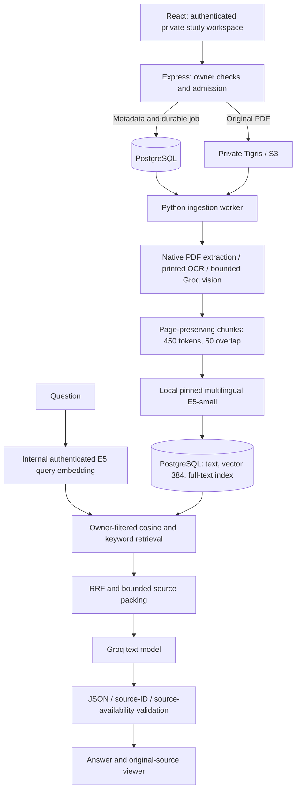

# Demonstrating and defending EduSphere RAG

This walkthrough uses real, small university PDFs, uploaded through the public API
and indexed by the deployed worker. They are retained in the requested account's
private **Operating Systems — Recruiter Demo** subject. The documents are historical
teaching material, not a claim about a currently running university course.

For the full platform and 130 interview questions, read the
[complete interview guide](edus-interview-guide.md). For infrastructure and operational
checks, read the [deployment report](deployment-verification.md).

## 1. What was downloaded

| Source | Author/institution | Bytes | PDF pages | Indexed chunks |
| --- | --- | ---: | ---: | ---: |
| [Operating Systems syllabus, Fall 2024](https://www.sci.brooklyn.cuny.edu/~briskman/cisc/3320/MW3/F24_CISC3320_MW3_Abridged_Syllabus.pdf) | Miriam Briskman, CUNY Brooklyn College | 353,180 | 7 | 12 |
| [Deadlocks lecture notes, Summer 2006](https://webhome.cs.uvic.ca/~pan/csc360k06/k-lock.pdf) | Jianping Pan, University of Victoria | 90,774 | 5 | 5 |

Both are smaller than 1 MiB. Their private server copies are in
`/home/priyanshu/EDUS-demo/operating-systems/`. `sources.json` records original URLs,
attribution, exact byte counts, page counts, and SHA-256 checksums. The syllabus states
CC BY-NC 4.0; no redistribution license is asserted for the lecture notes. Original PDFs
are not committed to this repository or published as an unrestricted download mirror.

Each document became `ready`. The worker used native extraction on ten pages and
native extraction plus Tesseract on two. The resulting **17 chunks have 384-dimensional
vectors** in the real PostgreSQL database. No fabricated fixture replaced these PDFs.

The full server-side evidence is saved beside the files:

- `live-results.json`: actual answers, source pages, checks, and scope.
- `retrieval-trace.json`: query embeddings' dimensions and actual candidate rankings.
- `demo-subject.png`, `demo-answer.png`, `demo-source-page.png`, and
  `browser-verification.json`: the real hosted UI, returned answer, and PDF page viewer.

Sanitized evidence is also committed here: [source manifest](demos/operating-systems/sources.json),
[actual test results](demos/operating-systems/results.json), and
[retrieval trace](demos/operating-systems/retrieval-trace.json). Private account identifiers
and signed links are omitted.

Treat answer timings carefully: a successful attempt's request duration excludes
quota waiting before that attempt. They are not end-to-end latency benchmarks.
Free model capacity caused minute-window waits during this run.

## 2. A recruiter demo that proves more than generic OS knowledge

1. Sign in to the account that owns the demo. Open **EDU AI → My Study Subjects →
   Operating Systems — Recruiter Demo**. Show both source records as ready.
2. Choose **My sources only**. In the source selector, select the notes alone and ask
   for the four necessary deadlock conditions. Open the returned reference at **PDF
   page 3**. This PDF prints multiple lecture slides per PDF page; slide number and
   PDF page number are different.
3. Select the syllabus alone. Ask: **“According to this uploaded syllabus, when are
   office hours and where are they held?”** Open the source at **PDF page 2**. This
   course-specific detail is stronger evidence of document use than a common OS answer.
4. Select the notes and ask whether a graph cycle always proves deadlock. The relevant
   qualification appears on **PDF page 4**. Explain how the answer changes with resource
   instance counts, rather than accepting an oversimplified answer.
5. Select only the syllabus and ask for its Kubernetes version and AWS production
   account ID. The desired behavior is an explicit lack-of-evidence response, not a guess.
6. Optionally generate flashcards or a quiz on “Deadlock.” Leave time between hosted
   requests; the free organization allowance is shared with the rest of the application.

Do not edit the documents to insert an expected answer and present it as an independent
test. Do not describe a saved screenshot as live generation. The current chat is held
in page state, so leaving/reloading clears its conversation; the source documents remain.
The saved results file preserves this evaluation separately.

### What the tests check

The evaluation checks answer content against the original PDFs and verifies that a
returned source belongs to the selected document and expected PDF page. The unsupported
question checks `insufficientEvidence=true` and `generalKnowledgeUsed=false`.

On 19 November 2026 (India), **all four acceptance cases passed**:

| Test | Observed result | Reference |
| --- | --- | --- |
| Four deadlock conditions | All four returned correctly | Notes PDF page 3 |
| Course-specific office hours | Correct day, time range, and online platform | Syllabus PDF page 2 |
| Cycle qualification | Correct distinction between single and multiple resource instances | Notes PDF page 4 |
| Unspecified Kubernetes/AWS details | Explicit insufficiency, no general-knowledge substitution | Syllabus-only scope |

The trace also shows an important limitation: the verbose questions yielded no lexical
matches and used semantic candidates. A separate `deadlock` keyword probe produced both
vector and lexical matches with fused scores. The needed notes page was semantic rank
three for the conditions question and still reached the context; the syllabus page was
rank two for the office-hours question. Do not call these top-one retrieval successes.

The hosted Chromium check also passed: it opened the retained subject under its actual
owner, displayed both university PDFs, generated the syllabus answer through the real
frontend/API, and opened the original at **page 2 of 7**. The screenshots are saved on
the server, not reconstructed mockups. No account token, cookie, or personal login email
is included in the committed evidence.

This is a small acceptance test, not a statistical accuracy benchmark. With only five
notes chunks, all notes may fit in the candidate/context bounds. Correct answers here
prove the deployed path works, but do not establish large-corpus ranking quality,
hallucination rate, p95 latency, or handwriting accuracy. Inspect the saved results for
the actual outcomes rather than assuming every future model response will be identical.

## 3. Your short explanation

> “EduSphere's RAG system answers from each user's private syllabus and notes. I prepare
> the material asynchronously, extract text or OCR it, split it into bounded chunks,
> generate local E5 embeddings, and store them in PostgreSQL with pgvector. A question
> is embedded with the same model. The backend filters sources by ownership, combines
> vector and keyword retrieval, and gives bounded evidence to Groq. The answer includes
> source references, and I validate those references before returning it.”

Then show the course-specific syllabus question and open its cited source. That connects
the architectural explanation to something the interviewer can inspect.

## 4. Separate ingestion from question answering

### Ingestion in concrete steps

The API authenticates the account and checks workspace ownership. It admits the file
only after count, storage, and request-rate checks. PDF bytes travel through bounded
Express multipart handling; the server checks actual size, a PDF header, and SHA-256
before writing an immutable private object key. Actual PDF/page validation happens in
the worker as well: a header alone is not sufficient validation.

Metadata and a durable job live in PostgreSQL. The worker claims a job with a lease,
downloads the original, and extracts text page by page. Printed images use Tesseract;
difficult pages can use allowlisted Groq vision within its capacity. Pasted text skips
object storage and OCR, then joins the same chunk/embedding pipeline.

Chunking preserves PDF page identity. E5 converts chunks into normalized 384-dimensional
vectors. The worker publishes pages/chunks/status atomically only if it still owns the
lease and the document/workspace has not been deleted. Slow OCR/model calls stay outside
long SQL transactions. Model weights are pinned to an immutable revision for consistency.

### Question answering in concrete steps

1. Authenticate; verify the requested subject and selected source IDs belong to the user.
2. Embed the question using the internal local service with the same model/revision.
3. Build the authorized eligible chunk set before running either retrieval branch.
4. Take up to 24 cosine-nearest candidates and up to 24 full-text candidates.
5. Fuse ranks, consider the top 16, deduplicate, and pack at most eight sources within
   roughly 10,000 excerpt characters, with 1,800 characters per excerpt.
6. Send the question and evidence to the Groq text model under the shared quota budget.
7. Parse/validate the structured result and reject unknown source references. Recheck
   source availability before returning a response.
8. The browser opens a short-lived authorized original PDF link at the cited page.

The model does not learn new weights from an upload. The extracted text, vectors, and
references form an external searchable corpus. RAG is retrieval plus generation, not
fine-tuning.

## 5. What PostgreSQL, pgvector, and E5 each do

These are three different responsibilities:

| Component | Responsibility | What it does not do |
| --- | --- | --- |
| E5 model | Produces numeric embeddings for chunks/questions | Does not store accounts or enforce document access |
| PostgreSQL | Stores durable relational state, text, jobs, quotas, and relationships | Does not learn embeddings from PDFs by itself |
| pgvector extension | Adds vector data/operators to PostgreSQL for similarity search | Does not replace the embedding model or generation model |
| Groq-served text model | Generates an answer from the supplied evidence | Does not automatically know which private documents it may access |

The encoder is `intfloat/multilingual-e5-small`, with `query:` and `passage:` input
conventions. Query and document encodings must remain compatible. Different models
can produce vectors with the same dimension but entirely different meanings.
[E5 model card](https://huggingface.co/intfloat/multilingual-e5-small).

The study tables use `embedding vector(384)`, not a JSON string search approximation.
The application can serialize a query vector for SQL transport, but PostgreSQL casts
it to a vector before comparing it. Original PDFs stay in object storage; chunks,
vectors, page identities, and source metadata stay in PostgreSQL.

## 6. Why I chose PostgreSQL with pgvector

Frame this as a decision under requirements, not “pgvector is always the best.”

**Existing infrastructure:** EduSphere already uses PostgreSQL/Neon. Adding an extension
keeps the first deployment smaller than operating another database and synchronizing it.
Neon supports the pgvector extension. [Neon documentation](https://neon.com/docs/extensions/pgvector).

**Authorization near the data:** retrieval joins chunks to document/workspace ownership
before ranking. Keeping those relationships together makes it easier to consistently
exclude other users' or deleted material. Database choice alone does not establish
security; the predicates still need correct code and tests.

**Atomic publication:** extracted pages, their chunks, and document readiness can be
published in one database transaction. A separate vector service would add a consistency
boundary: what happens if SQL succeeds but vector publication fails, or deletion only
succeeds in one system?

**Hybrid retrieval:** PostgreSQL already provides lexical text search, so one query can
combine semantic and keyword candidates without another search engine.

**Operational scope:** durable jobs and shared quota counters already need a reliable
database. Reusing it reduces credentials/services and keeps SQL inspection straightforward.
It does not make storage, compute, or queries unlimited or costless.

**Current corpus limits:** each account has six subjects and bounded sources. Exact
vector search is a reasonable starting point to measure before adding approximate indexes
or a separately scaled search platform.

Tradeoff: the same database serves metadata, job coordination, counters, and search.
Those workloads can compete. As the corpus/concurrency grows, measure query plans and
latency; consider partitioning, connection management, ANN indexes, or an independent
vector service. Reusing PostgreSQL reduces initial complexity, not every future bottleneck.

## 7. Search math and indexes

For query vector q and document vector d:

`cosine similarity = dot(q,d) / (norm(q) × norm(d))`

With normalized vectors, this equals the dot product. The application orders pgvector
cosine distance (`<=>`) ascending. A distance is not a calibrated probability that the
answer is true. [pgvector documentation](https://github.com/pgvector/pgvector).

The lexical side uses PostgreSQL `websearch_to_tsquery('simple', question)` and
`ts_rank_cd`, with a GIN index on the stored search vector. It is **not BM25**. The
current vector search has **no HNSW/IVFFlat index**; the presence of pgvector is not
evidence that approximate nearest neighbors are implemented.

Reciprocal rank fusion scores a candidate as:

`RRF(chunk) = sum(1 / (60 + rank in each retrieval list))`

A candidate ranked first semantically and tenth lexically receives `1/61 + 1/70`,
about 0.03068. A candidate ranked second only semantically receives `1/62`, about
0.01613. This avoids combining incomparable raw distance and lexical score scales.

A branch can return no candidates. In particular, a verbose full-sentence query can
be too restrictive for the current lexical AND semantics; the semantic branch still
provides candidates. The saved trace distinguishes actual branch contributions rather
than claiming every answer used both branches. Query cleanup and better lexical query
construction are measurable future improvements.

The 17 demo vectors contain `17 × 384 × 4 = 26,112` raw float32 value bytes. This excludes
chunk text, SQL rows/indexes, backups, and model weights. Do not present it as total
database storage or memory use.

## 8. Defend the alternatives

| Alternative | Why it was not the first choice here | When to reconsider |
| --- | --- | --- |
| Whole PDF in every prompt | Repeated context/token use; weak bounded behavior on large material | A tiny one-off document can fit, but it does not replace the general lifecycle |
| Fine-tuning | Requires a training lifecycle; not an automatic private, fresh, revocable knowledge store | Behavior/style or a well-defined supervised task |
| FAISS | Useful similarity-search library, but not the existing durable authorization/job database | Local high-throughput indexing with separately designed metadata/persistence |
| Chroma | Another storage/service lifecycle alongside the existing application data | Fast prototyping or when its capabilities simplify a measured requirement |
| Pinecone/Qdrant/Weaviate | Additional service/configuration and metadata/vector consistency boundary | Independent scale, filtering/search capabilities, or managed operations justify it |
| HNSW immediately | Added index memory/build/tuning and approximate recall tradeoffs | Corpus/latency measurements justify ANN under actual owner filters |
| Larger embedding model | More server memory/CPU and potentially slower ingestion/querying | A labeled evaluation demonstrates enough retrieval-quality gain |
| Hosted embeddings | Additional credentials/provider quota/cost dependency | Quality or operations benefits justify the budget |
| Vision for every page | Consumes shared free allowance on pages native extraction can handle | Specific layouts empirically need it and capacity is provisioned |
| Learned reranker | More inference latency and operational complexity | Retrieval misses are measured and reranking improves held-out results |

“I can migrate later” needs a concrete plan: retain source identity and model versions,
backfill a new index, evaluate it, cut over under a feature flag, and support rollback.
Do not mix vectors from different encoders in the same similarity space.

## 9. Reliability, privacy, and free capacity

Jobs are at-least-once attempts with leases/heartbeats and fenced publication. An expired
worker cannot publish after losing its lease. Deletion tombstones remove a source from
new retrieval immediately; durable cleanup later removes objects and derived/indexed
data. S3 and PostgreSQL do not share an ACID transaction, so retries/reconciliation matter.
An already issued signed GET can remain valid until its short expiration.

Admin role does not override private study ownership. No database RLS policy is claimed:
this implementation enforces owner predicates in application SQL. Embeddings are not
encryption. Private to other users also does not mean “never sent externally”: selected
excerpts go to Groq, and difficult-page images may go to its vision model.

The generation wrapper restricts model identities and reserves shared/user capacity
before calling Groq. Local extraction/embeddings avoid hosted embedding calls but use
server resources. A Free-plan confirmation flag does not inspect or change billing;
the operator verified the account separately. There is no automatic paid fallback.

The host's vision output cap is 512 tokens in instruct mode; dense handwritten pages
can be partial. The current internet PDFs mainly validate native text plus printed OCR,
not handwriting accuracy. The separate deployment report records a synthetic page
successfully routed through the live vision worker.

The administrator-only Nginx change for larger uploads remains separate. These small
demo files passed the public proxy; that does not prove 20 MiB uploads are enabled.

## 10. Interview questions worth rehearsing

**How do you know it used the documents?** I uploaded independently sourced PDFs,
checked the stored pages/vectors, asked a course-specific question, and verified the
returned reference against the original PDF. That is evidence of this run, not proof
that the base model had never seen the public source during training.

**How would you make that proof stronger?** Add a controlled private document with a
new random fact, compare with and without retrieval, and check abstention/revocation.
Use a larger labeled set for ranking and factual evaluation. Never disguise a modified
document as an untouched independent source.

**What does this demo not prove?** Broad correctness, top-one ranking accuracy,
cross-language quality, large-scale latency, and handwriting success rates. With a tiny
corpus many chunks can fit in context, so candidate selectivity is not well tested.

**Why do embeddings help if all five notes chunks fit?** They are still computed and
ranked in the deployed pipeline, but this sample does not demonstrate their scaling
benefit. Larger mixed-topic corpora and retrieval ablations are needed for that claim.

**What if the top vector result is not the final cited page?** Retrieval supplies multiple
candidates; the model may select supporting evidence among them. Inspect Recall@k and
final citation support separately from top-one ranking.

**Why not filter private data after search?** Unauthorized candidates could consume the
top-k set or reach later processing. Scope eligibility before ranking and check again
after generation because deletion can happen during inference.

**Does a citation prove the answer?** It proves source identity/access checks passed,
not that every claim is entailed. Validate claim support and inspect the original.

**Why use two retrieval branches?** Embeddings handle paraphrases; lexical search helps
exact terminology. Either can fail; RRF combines available ranks without score calibration.

**What is your retrieval accuracy?** This small acceptance set has observed checks,
not a general accuracy figure. Build a held-out relevant-page set and measure Recall@k,
MRR/nDCG and ablations before claiming improvement.

**What would you improve first?** Evaluate real student queries, improve lexical query
construction and retrieval misses, then consider reranking/model/index changes based on
measurements. Add monitoring and fairness around free capacity.

**What happens when Groq limits are reached?** Requests return a quota response or OCR
becomes partial; there is no silent paid fallback. Account limits are shared, so another
feature can consume the same capacity. Demo with time for a reset and keep a labeled
recording or saved results as a fallback.

**Which parts were actually run?** The public upload API, private object storage, Python
extraction/embedding worker, PostgreSQL/pgvector, query embedding, retrieval, and Groq
generation. Browser verification separately checks the hosted UI and source viewer.

**What is the strongest engineering story?** Keeping evidence private and lifecycle-safe:
admission before storage, bounded processing, atomic publication, owner-scoped retrieval,
post-generation checks, and deletion that cannot be undone by a stale worker.
